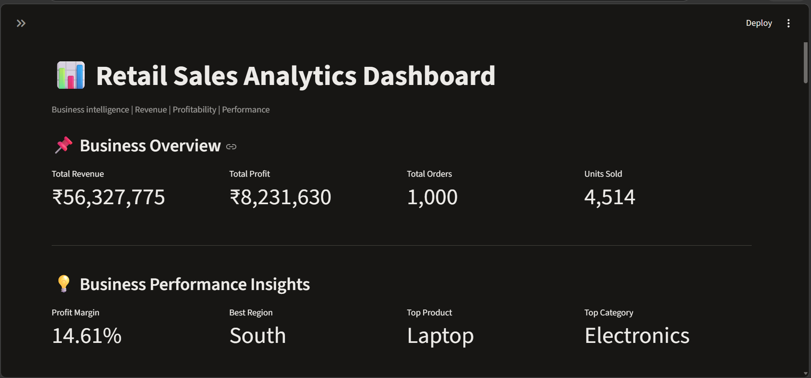
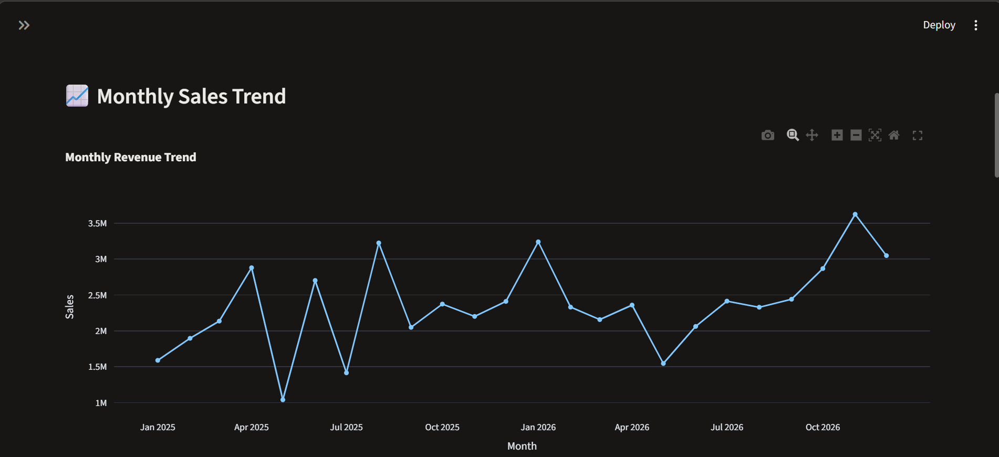
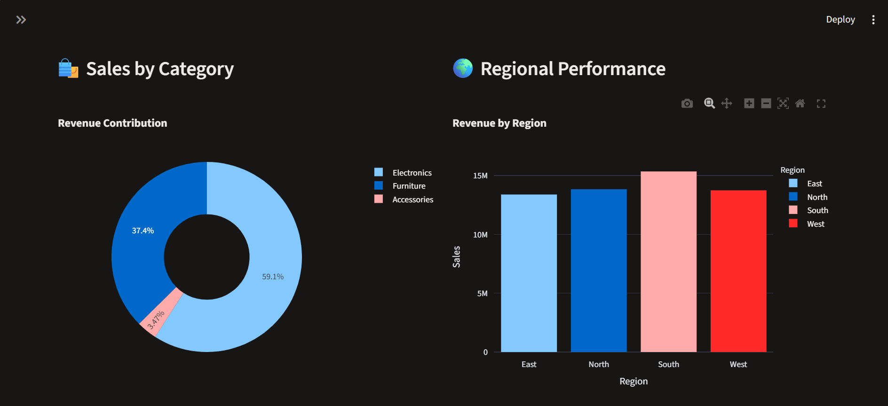
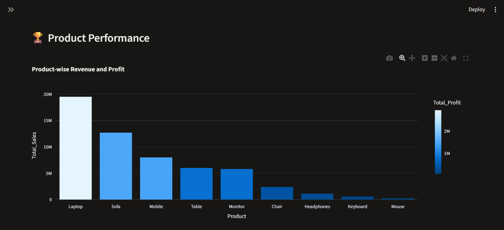
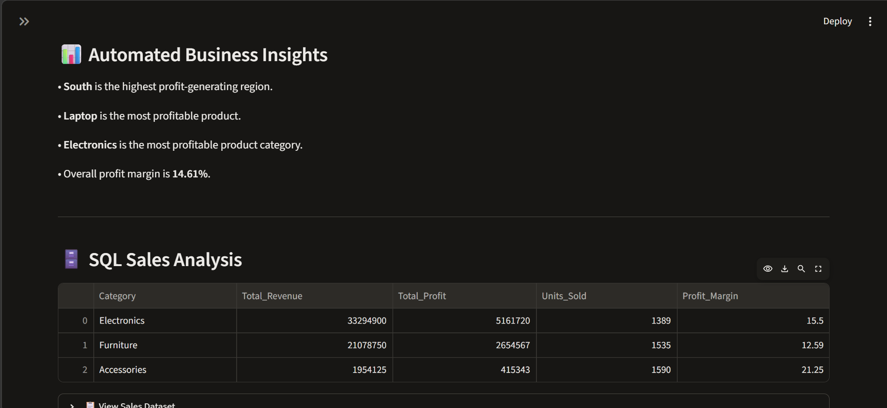

# 📊 Retail Sales Analysis Dashboard

An interactive Retail Sales Analytics Dashboard built using Python, Pandas, Streamlit, and Plotly to analyze sales performance and generate business insights.

## 🚀 Project Overview

This project analyzes retail sales data to help understand revenue, profit, product performance, and regional sales trends through an interactive dashboard.

**Note:** This project uses a generated synthetic dataset for demonstration and learning purposes. It does not contain actual business transactions.

## ✨ Features

- Interactive dashboard with Streamlit
- Total Revenue, Total Profit, Orders, and Units Sold KPIs
- Filter sales by region, category, and date
- Monthly revenue trend analysis
- Category-wise sales analysis
- Regional sales performance
- Product performance analysis
- Automated business insights
- SQL-based data analysis using SQLite
- Download filtered sales data as CSV

## 🛠️ Technologies Used

- Python
- Pandas
- Streamlit
- Plotly
- SQLite
- SQL

## 📁 Project Structure

```text
Retail_Sales_Analysis/
│
├── app.py
├── generate_data.py
├── sales_data.csv
├── requirements.txt
└── README.md
```

## ⚙️ Installation and Setup

1. Clone the repository:

```bash
git clone https://github.com/mrunali971/retail-sales-analysis-dashboard.git
```

2. Navigate to the project folder:

```bash
cd retail-sales-analysis-dashboard
```

3. Install dependencies:

```bash
py -3.13 -m pip install -r requirements.txt
```

4. Run the dashboard:

```bash
py -3.13 -m streamlit run app.py
```

5. Open the local URL displayed in your terminal.

## 🎯 Project Objective

The objective is to transform raw retail sales data into meaningful business insights using data analysis, visualization, and SQL.

## 👩‍💻 Author

**Mrunali Sawant**

B.Tech – Artificial Intelligence and Data Science Student

- GitHub: https://github.com/mrunali971
- LinkedIn: https://www.linkedin.com/in/mrunali16


---

## 📸 Dashboard Screenshots

### 1. Dashboard Overview


### 2. Monthly Sales Analysis


### 3. Category and Regional Analysis


### 4. Product Performance


### 5. Business Insights

